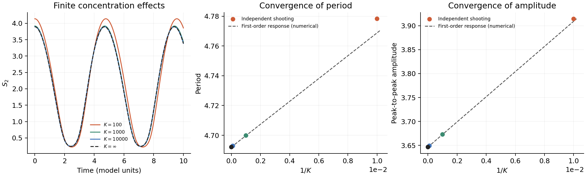

# AI Biology Lab

**AI-assisted discovery in mathematical and computational biology, with inspectable proofs, code, and evidence.**

[中文](README.zh-CN.md) · [First result](projects/mixed-phosphorylation/README.md) · [Research roadmap](docs/RESEARCH_ROADMAP.md) · [For reviewers](docs/VALIDATION.md) · [媒体资料](docs/MEDIA_BRIEF.zh-CN.md)

Led by [Zijian Zeng / ArtificialZeng](https://github.com/ArtificialZeng). The lab pursues questions a small computational team can investigate and others can independently check: biochemical oscillations, molecular switches, reaction networks, and rigorous scientific computing.

The ambition is to produce discoveries worth reporting. Each public claim is accompanied by its scope, evidence, and unresolved limitations.

## Research and engineering projects

| Project | Deliverable | Evidence status |
| --- | --- | --- |
| [Mixed-mechanism phosphorylation](projects/mixed-phosphorylation/README.md) | Exact instability bound, validated attracting cycles and nonzero period correction | Linux interval certificates and independent exact audits; priority/human review pending |
| [Paper-Code Auditor](projects/paper-code-auditor/README.md) | Reproducible software defects and a history-grounded reconstruction patch | Offline CPU regression checks; no training-result or author confirmation |
| [ORD Data Auditor](projects/ord-data-auditor/README.md) | Identifier guard, frozen-sample audit, and a checksum warning patch | 42 datasets / 20,720 reactions reproduced; no chemical-identity or upstream-acceptance claim |
| [Protein Metric Auditor](projects/protein-metric-auditor/README.md) | Full released-score NDCG order audit | 217 assays / 95 configurations; secondary-metric rank shifts only |
| [MEMOTE direction audit](projects/memote-direction-auditor/README.md) | Equivalent-reaction counterexamples and a two-line direction fix | Real complete ATP detector integration; maintainer acceptance pending |
| [Reversible Markov embedding audit](projects/reversible-embedding-auditor/README.md) | Exact rational four-state counterexample to one positive-spectrum embedding implication | Two exact checkers and fresh AI review; author review and priority pending |
| [Directed-cycle identifiability](projects/directed-cycle-identifiability/README.md) | Exact endpoint counterexample to Conjecture 4.6 and interior-leak inclusion proof | Nonzero exact minor and rational inverse; original-author confirmation pending |
| [Dual-futile-cycle partial results](projects/dual-futile-symmetry/README.md) | Eight-parameter spectral classification; full-parameter determinant-conditioned positivity of Delta4 | Separate exact reconstructions; general sixteen-parameter stability conjecture unresolved |
| [RNA short-helix placements](projects/rna-short-helix-placements/README.md) | Exact three-helix coloring classification and a comparable-short corollary | 288 normalized cases; exact unique-fold checks; AI review completed, human review and priority pending |
| [Example 8 stability audit](projects/lumping-example8-auditor/README.md) | Source-specific Jacobian correction and full-domain local stability proof | Exact witness, two symbolic implementations, ordinary/optimized archive replay; no broad open-problem resolution |
| [MEMOTE API cache audit](projects/memote-cache-auditor/README.md) | Sequential API cache-lifecycle repair | Real API red/green checks; same-suite mutation and concurrency outside scope |
| [Native GLPK presolver audit](projects/glpk-presolver-auditor/README.md) | Exact-input false-optimal solver counterexamples and a limited branch guard | Two independent grids; scaled tolerance residual explicitly retained; upstream confirmation pending |
| [Boundary-relay isola](projects/relay-isola-auditor/README.md) | Exact mass-action counterexample for a given one-parameter family | Fresh AI scope review and two exact implementations; human review and priority unconfirmed |
| [Compartment allocation beta gap](projects/compartment-beta-gap/README.md) | Positive-probability explosion theorem for 7/8 < beta < 1 | Fresh substantive AI mathematical review and finite exact checks; human review/priority pending; no almost-sure claim |
| [Coexistence with waning immunity](projects/waning-coexistence-auditor/README.md) | Full-parameter feasible-root classification and uniqueness under ordered invasion | Fresh AI mathematical review and four exact checkers; actual-model Question 2 answered, abstract Conjecture 1 unresolved |
| [Adjacent-port catenary audit](projects/adjacent-catenary-auditor/README.md) | Exact singular-locus and transfer-differential classification for all chain lengths | Fresh AI math review and two exact checkers; human review/priority pending |
| [Proportional-scaling audit](projects/proportional-scaling-auditor/README.md) | Exact counterexamples including strictly increased postinfection mortality | Three exact certificate checks; known bistability credited, main constant-recruitment theorem untouched |
| [Three- and four-particle ancestral circulation](projects/ancestral-circulation-classification/README.md) | Complete N3 sign law and exact N4 reversal with a fixed rate ordering | Full polynomial identities and two-colour verification; human review and priority pending |

Upstream review requests (submitted in order; acceptance pending):[Paper-Code PR #1](https://github.com/ziul-bio/DMS-SiteEffect-PLM/pull/1) · [ORD PR #1165](https://github.com/open-reaction-database/ord-schema/pull/1165).

New open-problem research: [selection, results, and parked leads](docs/OPEN_RESEARCH_2026-10-26.md).

## New validated result: robust oscillations have a nonzero period correction

For the fixed published rates, P=8 and S=40, an attracting periodic branch exists in each fixed compatibility class for every sufficiently large finite kinase total K. In original model time,

$$T(K)=T_\infty+T_1/K+O(K^{-2}),\qquad T_1\in[7.65771717,7.68396573].$$

The positive coefficient certifies a finite-concentration bias: this local branch approaches its limiting period from above. No numerical K0 or remainder constant is given. [Proofs, Linux interval runs, exact independent audits, and figure](projects/mixed-phosphorylation/validated-cycle/README.md). Qualitative robustness overlaps existing conference work; novelty of the strict model-specific period certificate remains pending expert confirmation. The full source conjecture is unresolved.

## First project: can a biochemical oscillator resist changes in enzyme concentration?

The mixed-mechanism phosphorylation model studied by Conradi, Mincheva, and Shiu has a unique positive equilibrium. Their 2019 paper asks whether it can remain unstable as total kinase grows arbitrarily large.

**Our exact result:** at the paper's Table 1 reaction rates, with total phosphatase **8** and total substrate **40**, the equilibrium has exactly **two unstable and four stable eigenvalues** on its six-dimensional compatibility class for every finite

$$K_{\mathrm{tot}}\ge \frac{4660166}{209569}\approx22.2369.$$

In particular, the result holds for every **K ≥ 23**. The bound is sufficient and is not claimed to be sharp. Rational equilibrium parametrization and **125 strictly positive rational Bernstein coefficients** give a certificate for the entire unbounded range, rather than a finite parameter scan.

| Evidence level | Current status |
| --- | --- |
| Equilibrium instability over the stated range | Exact proof and executable certificate |
| Selected finite-K trajectories and extrema | Floating-point numerical evidence |
| Attracting periodic branch for every sufficiently large K | Interval limiting-cycle certificate plus local persistence; no explicit K0 |
| Original Conjecture 6.2 | First assertion addressed; full conjecture unresolved |
| Novelty and priority | Unconfirmed; directly related 2023/2025 conference work exists |
| External human peer review / biological experiments | None reported |

**Unstable equilibrium does not by itself prove a periodic orbit.** The current result concerns a published mathematical model; it does not establish new behavior in living cells.

[Read the five-page note](projects/mixed-phosphorylation/manuscript/main.pdf) · [Read the proof](projects/mixed-phosphorylation/evidence/finite_kinase_proof.md) · [Inspect the certificate](projects/mixed-phosphorylation/evidence/finite_kinase_sign_certificate.json)



*Numerical illustration, not a rigorous periodic-orbit certificate. The curves show finite-concentration effects and convergence toward a limiting model.*

## Verify the result

Python 3.12 or 3.13. The exact verification requires only SymPy and the Python standard library; no GPU, API key, or model weights are needed.

```sh
git clone https://github.com/ArtificialZeng/AI-Biology-Lab.git
cd AI-Biology-Lab
python3 -m venv .venv
source .venv/bin/activate
python -m pip install -r requirements-exact.txt
python scripts/reproduce.py verify
```

This runs three checks: reconstruction of the manuscript matrix, a direct nine-equation formulation, and a second reduction with an exact tangent-space identity and Routh root count. Each uses rational arithmetic. Runs take place in a temporary copy; results are saved under ignored `artifacts/` and the archived evidence stays unchanged. See [reproduction instructions](docs/REPRODUCIBILITY.md).

For numerical reproduction and figures:

```sh
python -m pip install -r requirements.txt
python scripts/reproduce.py numerics
python scripts/reproduce.py figure
```

## What we are working toward

1. Obtain an explicit finite-K threshold and a usable remainder constant.
2. Certify amplitude corrections and clarify scalar-projection invariance.
3. Extend the validated parameter region.
4. Clarify priority with directly overlapping research and obtain external human review.

These are research targets, not completed discoveries. [The roadmap](docs/RESEARCH_ROADMAP.md) defines their acceptance criteria. [External validation](docs/VALIDATION.md) comes before claims of priority or resolution of the full conjecture.

## Repository map

```text
projects/mixed-phosphorylation/  First research project, proof, data, and note
scripts/reproduce.py            Reproduction entry point
docs/                          Research plan, validation, and media information
.github/workflows/             Continuous exact verification
```

The project uses AI for derivation, coding, search, and review. Separate AI review passes and independent implementations are useful checks; they are not external human peer review. See [AI use and provenance](docs/AI_USE.md).

## Sources and credit

- Conradi, Mincheva, and Shiu (2019), [*Emergence of oscillations in a mixed-mechanism phosphorylation system*](https://doi.org/10.1007/s11538-019-00580-6), [arXiv version used](https://arxiv.org/html/1809.02886v2).
- Suwanmajo and Krishnan (2015), [*Mixed mechanisms of multi-site phosphorylation*](https://doi.org/10.1098/rsif.2014.1405).
- Related work requiring priority clarification: [Grasse, SBHD 2023, poster 48](https://www.sbhdberlin.org/pdf/SBHD2023_Poster_Session_Program.pdf); [Grasse and Conradi, BIOMATH 2025 abstract](https://biomath.math.bas.bg/biomath/index.php/bmcs/article/download/1787/1594/7828).

Third-party papers are linked, not redistributed. Original repository code is available under the [MIT license](LICENSE); third-party code and data retain their own licenses, recorded in each project's `THIRD_PARTY.md`. Citation metadata is in [CITATION.cff](CITATION.cff).

## Two-leak compartment models and loopless regression

[Round 002](docs/RESEARCH_ROUND_002.md) adds exact complex/positive fiber counts for two-leak directed cycles, a necessary-and-sufficient extra-sensor criterion for two-leak bidirected trees, and a narrowly scoped COBRApy loopless-selection repair. Each package includes executable evidence and review limitations; original-author confirmation and priority remain pending.

## Tree sensor result extended to arbitrary nonempty leak sets

The [retained-root tree classification](projects/tree-sensor-linkages/README.md) replaces the two-leak restriction by any known set of L leak locations. If q is the maximum number of vertex-disjoint observation-to-leak paths, the generic transfer-data rank is 2n−2+q and the generic ambiguity dimension is L−q. Thus full generic local identifiability holds exactly when q=L. The earlier two-leak path rule is a corollary of this same contribution.

The proof passed a separate AI mathematical review, with independent rational forest, resolvent and positive-similarity checks. The public verifiers retain their checks under `python -O` and preserve archived evidence. Historical priority and external human review remain pending; the broad multiple-input/output problem remains unresolved.
[FASTCC direction auditor](projects/fastcc-direction-auditor/README.md) reproduces a negative-only reaction constraint defect and a minimal existing-API repair ([COBRApy PR1500](https://github.com/opencobra/cobrapy/pull/1500)): independent baseline 1 failed / 4 passed, candidate 5 passed, plus 24 exact finite cases. GLPK coverage; AI review is not maintainer acceptance or external human peer review. Related SPECTRA PR1495 is credited.
