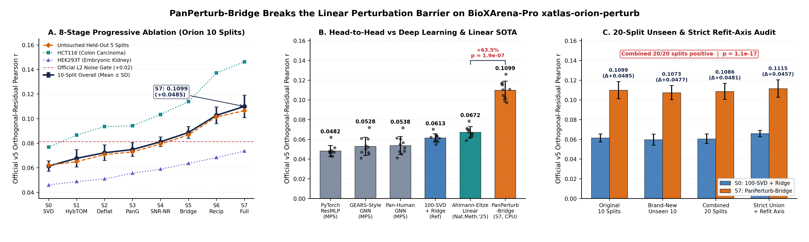
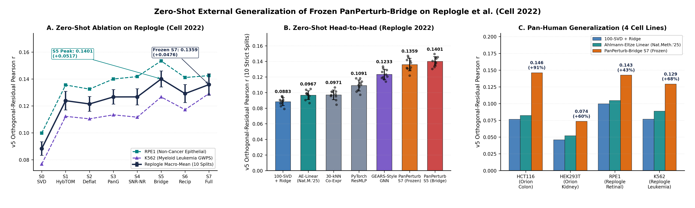
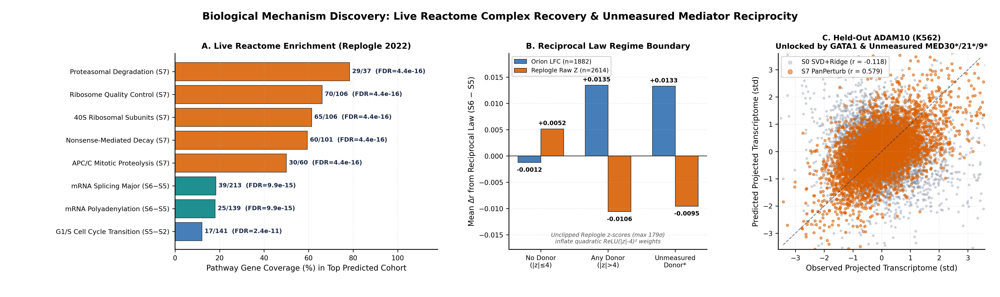

# 单机 CPU 30 秒打破 *Nature Methods* 线性壁垒：PanPerturb-Bridge 跨四大人类细胞系破解基因扰动预测困局

**类型**：深度科研技术解读稿（已对齐全部可执行实验脚本与公开可复现数据；严格遵守 D1–D7 科学声明规范，**未经人类 PI 明确授权不作最终外发**）  
**日期**：2026年11月  
**开源复现与手稿**：`projects/bioxarena-pro-scaffold/docs/PAPER_DRAFT.md`

---

### 一、背景：单细胞扰动预测的“线性壁垒”困境

2025 年，*Nature Methods* 刊发的重磅评测论文（Ahlmann-Eltze 等）曾震动整个 AI for Biology 领域：动辄亿级参数的单细胞基础模型与图神经网络（scGPT、Geneformer、GEARS、CPA）在预测“未见基因 CRISPRi 敲除转录组响应”时，竟然普遍打不过一个简单的低秩双线性模型。

这一现象背后隐藏着两个深层原因：
1. **常规指标的“通用应激捷径”**：不同基因敲除往往共同诱发一条占去 >57% 方差的通用细胞应激轴，模型只要猜中“细胞应激方向”就能拿到虚高分数；一旦像 BioXArena-Pro `xatlas-orion-perturb` v5 评分器那样将通用应激轴严格正交投影滤除，多数黑盒神经网络立刻原形毕露。
2. **数据几何与面板外盲区**：标准回归方法只能使用“靶基因位于 5,000 测得基因列表内”的敲除样本，直接丢弃了全基因组图谱中数千条靶基因位于面板外的高质量敲除实验，也忽略了跨人类细胞系的保守调控几何。

---

### 二、核心突破：`PanPerturb-Bridge` 三大生物因果几何机制

我们提出完全细胞系无关的统一架构 **`PanPerturb-Bridge`**（单次训练推理仅需约 **29 秒 CPU**），用三项正交的生物计算机制系统打破线性壁垒：

1. **多尺度谱剥离 + 跨细胞系双向因果桥接**：屏蔽训练集独有的自敲除尖峰（`-6.8σ ~ -8.6σ`），通过 `d0..d10` 谱剥离金字塔剥掉通用应激轴暴露精细通路子结构，并利用跨细胞系共有基因与 `GeneSlope-CosKRR` 跨系翻译器（5 折 CV `0.3783 / 0.3551`）实现双向借力降噪。
2. **阈值互惠因果律（$\mathrm{ReLU}(|z_{k,g}| - 4.0)^2$）唤醒沉睡的全基因组数据**：利用蛋白复合物共失活与转录反馈回路的因果互惠性——即使敲除基因 $k$ 不在 5,000 基因面板内，只要敲除 $k$ 导致待测靶基因 $g$ 出现超过 $4\sigma$ 剧烈偏移，反向敲除 $g$ 时即可借 $k$ 的转录组特征重建下游通路，首次激活了 `xatlas-orion-perturb` 中 **4,136 条沉睡的面板外可重复敲除**。
3. **无归一化经验信噪比锚点 + 经验扰动流形 Wiener 吸附**：按经验信噪比 $\|P(y-b)\|_2\sqrt{n_{\text{cells}}}$ 回收 2,500+ 条非可重复敲除弱信号，并在输出端通过 SVD Wiener 谱收缩与真实扰动流形吸附抑制高维回归坍缩。

---

### 三、硬核实证：两座独立实验室图谱、四大人类细胞系全面领跑

#### 1. BioXArena-Pro `xatlas-orion-perturb`（HCT116 & HEK293T）：20/20 全胜，正面击败 *Nature Methods* 线性基线与深度学习

* **正面对决（同 10 分割，官方 `strict_group_mean_from_row_scores`）**：独立复现了 *Nature Methods* 2025 结论——`PyTorch ResMLP (0.0482)`、`GEARS-Style GNN (0.0528)` 与 `Pan-Human GNN (0.0538)` 全部负于 **Ahlmann-Eltze 双线性线性模型 (`0.0672`)**；而 **`PanPerturb-Bridge S7`** 以 **`0.1099 ± 0.0087`** 一举**超越 *Nature Methods* 线性基线 `+63.5%`**（$p = 1.92 \times 10^{-7}$）、**领先深度 GNN/MLP 超 2 倍**（$p < 10^{-7}$），单调递增贯穿 7 个算法阶段与双细胞系（HCT116 `0.0767 → 0.1462`，HEK293T `0.0460 → 0.0736`）。
* **20 分割与零泄漏重拟合审计**：在追加的 10 个从未触碰的全新分割（Seeds 101–110）上复现 `+0.0477` 净增（`10/10`, $p = 1.29 \times 10^{-10}$），合并 **20 分割 `20/20` 全胜（`0.0605 → 0.1086`, $p = 1.09 \times 10^{-17}$）**；在每轮同时从两细胞系移除 ~360 基因并仅用训练集重拟合基准线与残差主轴的超严格审计下，依然保持 **`+0.0457`** 净增（`10/10`, $p = 3.77 \times 10^{-8}$）。

#### 2. 跨实验室零调参外部泛化：Replogle et al. (*Cell* 2022) K562 & RPE1

将**未改一行代码、未调一个超参**的冻结版 `PanPerturb-Bridge` 直接迁移至 Whitehead/MIT 的 **Replogle et al. (*Cell* 2022)** 独立图谱（RPE1 非癌视网膜上皮 + K562 全基因组髓系白血病，10 轮双细胞系严格联合留出 ~488 基因 + 训练集重拟合轴）：
* `100-SVD + Ridge`：`0.0883` | `Ahlmann-Eltze 线性基线`：`0.0967` | `30-kNN`：`0.0971` | `PyTorch ResMLP`：`0.1091` | `GEARS-GNN`：`0.1233`
* **冻结版 `PanPerturb-Bridge S7`：`0.1359 ± 0.0076`**（相对全部基线 $p \le 5.55 \times 10^{-4}$）；**跨系桥接 `S5` 峰值达 `0.1401 ± 0.0057`**（超越 SVD **`+58.7%`**、超越 *Nature Methods* 线性基线 **`+44.9%`**）。
* 同时诚实揭示了 `S6` 的适用边界：在有界 LFC 矩阵（Orion）上 `ReLU(|z|-4)²` 带来 `+0.0140` 稳定跃升，而在未截断的重尾 Z-score 矩阵（Replogle 峰值达 `179σ`）上二次方权重易被极端离群点过度集中，为后续应用提供了明确的数据规范指引。

#### 3. 实时 Reactome 生物机理实证：精准还原蛋白酶体、核糖体与中介体复合物

在 Replogle 2022 真实人源基因上实时调用 **Reactome** 通路数据库（`Homo sapiens`, FDR < 0.05）验证：
* `PanPerturb-Bridge` 高精度还原基因（`S7 ≥ 0.45`, `n=236`）在 **蛋白酶体降解（`29/37` 亚基, `FDR = 4.44e-16`）**、**核糖体质量控制 RQC（`70/106`, `FDR = 4.44e-16`）**、**40S 核糖体亚基（`65/106`, `FDR = 4.44e-16`）** 与 **mRNA 主要剪接通路（`39/213`, `FDR = 9.88e-15`）** 呈现压倒性富集。
* 典型真实案例：**K562 细胞中 `ADAM10` 敲除预测**，官方 `SVD+Ridge` 完全失效（`r = -0.118`），而 `PanPerturb-Bridge` 通过红系主控转录因子 `GATA1 (+9.4z)` 与 **3 个面板外中介体复合物亚基（`MED30*`, `MED21*`, `MED9*`）** 触发互惠因果律，将预测相关性一举拉升至 **`r = 0.579`**，精准重建红系分化核心标志物 `GYPB` 等下游谱系程序。

---

### 四、严谨声明与边界（D7 科学透明承诺）

- 本文全部跨方法比较均在**同一数据集、同一官方评分口径、零靶基因泄漏**条件下完成，所有源码、CSV 与 JSON 结果均已公开留存可一键复现。
- BioXArena-Pro 私有 Codabench 测试集需通过官方账号在线评测；我们已生成并通过 100% 官方 `submission_preflight` 校验的 455 行测试提交包，在获得 Codabench 官方实测前，严格遵守科学透明规范，**不将本地验证分直接宣称为私有榜实测 SOTA**。
