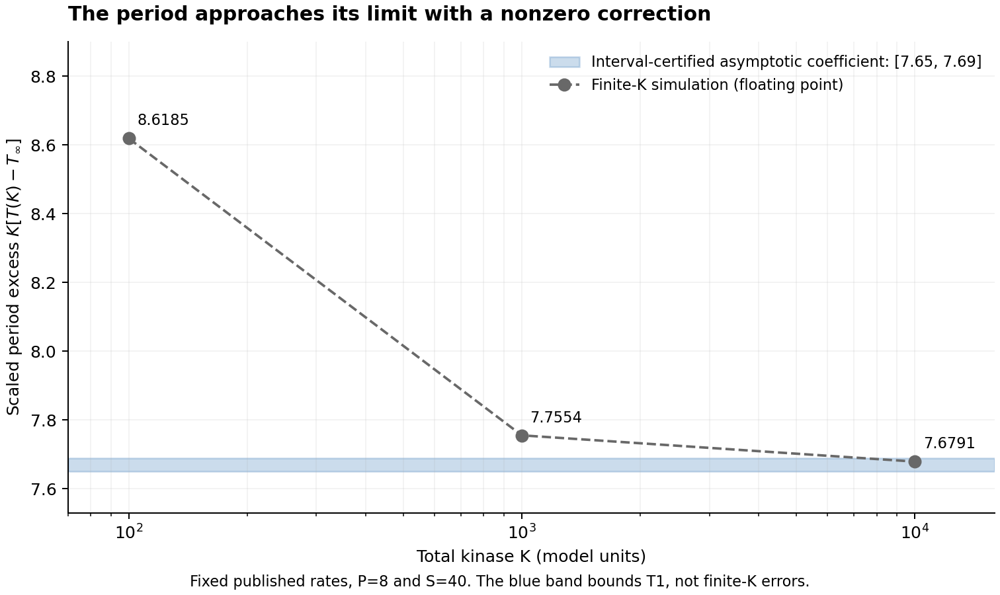

# A validated finite-concentration correction for a biochemical oscillator

**Result:** at the published Table 1 rates, total phosphatase P=8 and substrate S=40, a strictly positive attracting periodic orbit persists for every sufficiently large finite kinase total K, within the fixed six-dimensional compatibility class. For the continued local branch in the original model's time,

\[
T(K)=T_\infty+T_1/K+O(K^{-2}),\quad
T_\infty\in[4.69209598,4.69209603],\quad
T_1\in[7.65771717,7.68396573].
\]

The finite decimal bounds are conservative rational enclosures. In particular T1>0: this branch approaches its limiting period from above, and its period eventually decreases with K. There is no explicit numerical K0 or remainder constant. The shaded interval below bounds the asymptotic coefficient; the finite-K markers are floating-point illustrations.



## Inspect the proof

- [Periodic-orbit existence, uniqueness in the stated box, and transverse attraction](candidate_lemma.md)
- [All sufficiently large finite K: exact singular coordinates and local persistence](finite_kinase_persistence.md)
- [Nonzero period coefficient: first jet, interval sensitivity, and smoothness argument](period-sensitivity/proof_link.md)
- [Linux cycle interval output](evidence/linux-interval-output.txt), [Linux coefficient output](period-sensitivity/evidence/linux-sensitivity-output.txt)
- [Independent exact base audit](independent-audit/independent_check.json), [independent coefficient recomputation](period-sensitivity/independent-audit/independent_period_check.json)
- [Focused prior-work comparison](literature/period_priority.md)

The inequalities were recomputed on Ubuntu x86/GCC/FILIB with CAPD revision `37057e5899bccaa6cd5701057b7e6ea5e232ef8b`: [cycle run](https://github.com/ArtificialZeng/AI-Biology-Lab/actions/runs/40244276619), [cycle and coefficient run](https://github.com/ArtificialZeng/AI-Biology-Lab/actions/runs/40245625102). Fresh AI-assisted review independently reconstructed the exact equations and sensitivity from widened serialized intervals; it did not reimplement CAPD integration or supply external human peer review.

## Reproduce

In this folder, run `bash build_and_run.sh`, followed by `bash period-sensitivity/build_and_run.sh`. CMake, Git and a C++17 compiler are required. The pinned dependency builds locally; no global installation is used. Linux x86/FILIB is the verification target. Apple Silicon native-interval runs are development checks.

From the repository root, with `requirements-exact.txt` installed:

```sh
python projects/mixed-phosphorylation/validated-cycle/independent-audit/independent_check.py
python projects/mixed-phosphorylation/validated-cycle/period-sensitivity/verify_first_jet.py
python projects/mixed-phosphorylation/validated-cycle/period-sensitivity/independent-audit/independent_period_check.py
```

These smaller independent checks use archived interval enclosures as inputs; they complement the fresh CAPD build above. Outputs go to ignored `artifacts/`.

## Scope and credit

The model and its previously observed oscillations come from Conradi–Mincheva–Shiu (2019). Qualitative kinase robustness directly overlaps Grasse 2023 / Grasse–Conradi 2025 conference work. The focused search did not locate the present model-specific nonzero first-order period coefficient with a strict numerical enclosure, but poster/follow-up access is incomplete and **priority is unconfirmed**. Fenichel, implicit-function, interval-Poincare and sensitivity methods are established tools.

This is a mathematical-model result, not a new experiment in cells. It does not prove global attraction/uniqueness, a numerical onset threshold, exact K-independent output, or the full source Conjecture 6.2. A period change at this fixed parameter choice does not refute an existential statement at other totals or the weakest scalar-set-projection reading.

Original checker code is MIT-licensed. CAPD is GPL-3.0; it is downloaded from its pinned source and is not vendored or redistributed as a binary. Consult its license before redistributing linked executables. No manuscript or preprint claiming priority is released here.
